# Research on Waveform Design and Signal Processing for Integration of Wireless Communication and Radar Perception[with MATLAB Code]

Summary: Due to the "non-intelligent" nature of traditional radar signals in terms of the information they convey within their occupied bandwidth, radar and wireless communication integrated systems will become a unique platform for intelligent transportation networks in the future. They can achieve key tasks such as environmental perception and self-organized communication link allocation. This paper proposes an intelligent waveform design method suitable for executing data transmission and radar sensing simultaneously, based on the classic phase coding waveforms used in wireless communications. Specifically, it investigates the requirements for high dynamic range radar measurements using such signals, discusses various possible radar processing algorithms, and also considers the applicability of multi-antenna technology in direction of arrival estimation. In addition to theoretical analysis, this paper also presents system simulations and measurement results for the complete "RadCom" system, verifying the feasibility of integrating communication and radar applications in practice.
Introduction: In the current technological development process, the front-end architecture of radio frequency (RF) in both radar and wireless communication technologies is becoming increasingly similar. Especially, the number of functions traditionally implemented by hardware components is increasing, and is now gradually being replaced by digital signal processing. At the same time, the carrier frequencies used by communication systems have shifted towards microwave bands, which are at the same numerical scale as those used in traditional radar applications. Therefore, with today's technology, it is easy to realize a joint RF hardware platform suitable for communication and radar applications, which will provide unique possibilities for new system concepts and applications.
More importantly, by adopting joint waveforms for both applications, the spectrum can be efficiently utilized, and both applications can run simultaneously, ensuring that both functions are always available and helping to address the issue of limited spectrum resources to some extent. Such systems that utilize a single waveform on a single hardware platform to provide radar and communication functions simultaneously are referred to hereafter as the "RadCom" system.
The field of radar communication systems is vast, benefiting numerous sectors, especially intelligent transportation applications. Such applications require not only the establishment of communication links with other vehicles but also active environmental perception capabilities. With appropriate system platforms, all vehicles on the road can participate in a collaborative radar sensor network, achieving unique safety features and intelligent traffic route planning.
Moreover, compared to systems solely providing pure vehicle-to-vehicle communication functionality, those that also have communication and radar capabilities are easier to market. Pure vehicle-to-vehicle communication systems can only provide information when there is a communication partner, so consumers are not enthusiastic about installing such systems during the early stages of market promotion. However, radar communication systems, with their radar perception capabilities, can bring practical benefits to consumers regardless of market penetration rates.
Furthermore, in joint systems, both applications are expected to benefit from each other through information sharing. For example, the radar application can utilize information circulated on the communication network to improve detection probability and accuracy. Ultimately, it may even be possible to fully integrate radar images from different platforms, breaking through signal propagation limitations significantly expanding the sensor's detection range.
The main challenge in the development of radar communication systems lies in finding suitable waveforms that can be used for information transmission while also meeting the requirements of radar sensing. Therefore, the core content of this paper is to determine and evaluate different methods to achieve this goal. It should be emphasized that although the focus of this research is on automotive applications, the concepts and waveforms discussed herein are equally applicable to any scenarios requiring both radar sensing and communication functions, such as aviation and military applications.
The traditional radar waveform design aims to generate waves with optimal autocorrelation characteristics, ensuring high dynamic range measurement in receivers through correlation processing. A typical example of meeting this requirement is the linear frequency modulation (LFM) pulse, also known as a "chirp" signal [1]. Therefore, the most intuitive method for designing joint waveforms is to incorporate LFM into data encoding, as demonstrated in the literature [2]. Another approach reported in [3] involves using LFM pulses for covert communication. However, both methods share a common drawback: the communication symbol rate is only related to the chirp rate, and under the same bandwidth, it is typically several orders of magnitude lower than the symbol rate that dedicated communication systems can achieve. Therefore, from a communication perspective, this method is not optimal and will not be considered further.
To achieve superior communication performance in terms of symbol rates, continuous transmission signals derived from digital communication must be employed. Spread spectrum signals are a typical communication waveform with good autocorrelation properties, making them an ideal choice for joint radar and communication applications [4]. In recent years, advanced concepts based on multicarrier communication waveforms have emerged [5]. By utilizing multicarrier waveforms, frequency domain processing techniques can be applied, thereby reducing the need for autocorrelation properties. The main sections of this paper will focus on continuous single-carrier and multicarrier waveforms, as these concepts have the greatest potential for providing high performance for radar and communication simultaneously.
The waveforms used, as well as the general parameters of the system (such as bandwidth), must be selected according to the needs of both applications. At first glance, it appears that the conditions for optimal signal parameters differ from those in communication and radar applications. For example, to achieve high resolution, radar sensors require a larger signal bandwidth, which is typically much greater than the typical bandwidth of communication signals. The section on waveform design will discuss how to reasonably select system parameters to find an optimal solution that meets the needs of both applications simultaneously. Additionally, waveform design must also meet some additional requirements, with the most important being: regardless of the data transmitted, radar sensing should be possible, only then can efficient spectrum reuse be achieved.
In environments with moving objects, receiving signals will experience Doppler shifts, which are detrimental to information transmission quality, but they also contain valuable information about the speed of reflective objects. Therefore, it is necessary to find a strategy: during information transmission, one can tolerate the effects of Doppler shifts; while in radar processing, these speed information can be fully utilized. Radar processing algorithms should support independent estimation of distance and speed for multiple objects. In addition to simple distance measurements, obtaining Doppler information is particularly important for vehicle active safety applications such as collision detection before impact.
Additionally, multi-antenna technology has garnered significant attention in communication applications, with commercial systems now gradually emerging. This type of technology is commonly referred to as Multi-Input Multi-Output (MIMO) or Smart Antenna Technology. Its core idea is to combine the received signals from multiple antennas intelligently to achieve optimal signal-to-noise ratio and highest data rate. The signal combination is then converted into baseband in the digital domain, facilitating the application of various algorithms. This process can also be understood as adaptive processing of virtual beamforming patterns to enhance directional gain and suppress interference. After analyzing MIMO and DBF, it becomes evident that they share many similarities: both are based on distributed antenna structures, employ the same receiver concept (baseband conversion and sampling of signals from all antennas), utilize full-digital signal processing, and both generate virtual array beamforming patterns to maximize information acquisition. Given these considerations, digital beamforming radar and MIMO communication can be seamlessly integrated into radar communication systems to achieve improved spatial resolution and performance.
To implement the joint application of digital beamforming radar and MIMO communication, it is necessary to find suitable working bands. Wireless Local Area Network (WLAN) standards, like those used in industrial, scientific, and medical (ISM) bands, operate without permission for any device. For radar applications to achieve sufficient resolution, a certain minimum bandwidth is required, typically at least 100MHz. The 24GHz ISM band is globally available and meets this requirement. Currently, there are commercial vehicle radar sensors operating in this frequency band that are highly integrated [8]. However, as the carrier frequency increases, free-space attenuation will increase and diffraction effects will decrease, leading to a sharp reduction in communication reach. Considering the minimum bandwidth requirement, the current 24GHz ISM band seems to be the best choice for radar communication systems that require no authorization.
In the following sections, we will delve into the possibility and existing limitations of fully integrating wireless communication with radar sensing, with a particular focus on intelligent transportation applications. Specifically, we will delve into possible methods for waveform design, as well as appropriate processing techniques for estimating distance, Doppler shift, and direction of arrival from reflected signals, and validate these through system simulations and measurement results. Section 2 will identify and describe waveforms that can be applied simultaneously to wireless communication and radar, while also discussing typical radar communication application scenarios and requirements; Section 3 will explore the application method of single-carrier signals combined with spread spectrum technology, and evaluate it through simulation; Section 4 will similarly introduce advanced methods based on multi-carrier waveforms and provide their simulation and measurement results; Section 5 will discuss the application of multi-antenna processing technology; finally, Sections 6 and 7 will elaborate on the considerations for achieving practical system operation ranges in the 24GHz frequency band, and draw overall conclusions.
Conclusion: Currently, the concept of vehicle-to-vehicle communication is based on the availability of specific allocated spectrum, such as the 5.9GHz band. However, it is widely known that automotive radar has broader spectrum resources in the 24GHz and 76GHz bands. This study shows that these radar spectrums can carry information without any negative impact on radar performance. On the other hand, by leveraging the concepts proposed in this paper, vehicle-to-vehicle communication systems operating at the 5.9GHz band can also be equipped with additional radar capabilities.
This paper investigates two waveform design solutions capable of achieving simultaneous wireless communication and radar operations, namely Orthogonal Frequency Division Multiplexing (OFDM) and Direct Sequence Spread Spectrum (DSSS), and comprehensively evaluates their feasibility and performance. The research results indicate that the OFDM solution offers numerous advantages in radar application performance, including high dynamic range, unaffected by transmission user data, ability to estimate relative speed, and efficient implementation based on Fast Fourier Transform (FFT). On the other hand, the DSSS solution facilitates multi-user separation in communication applications. Additionally, the feasibility of the OFDM solution in real road scenarios was verified through a dedicated system demo.
The paper also confirms that these waveforms can effectively support multi-antenna receivers and beam direction estimation processing technologies. In terms of angle focusing, beyond traditional methods based on Fourier transform, the study found that the Multi Signal Classification (MUSIC) algorithm can achieve high angle resolution with only four receiving antennas.
In summary, the waveform design concepts discussed in this paper provide an attractive prospect for the development of future intelligent sensor devices. Such devices can utilize a single universal signal to simultaneously achieve spectral-efficient radar sensing and communication functions, and achieve cost-effective device deployment through a single universal hardware system.
End

## Images

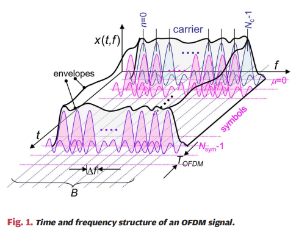
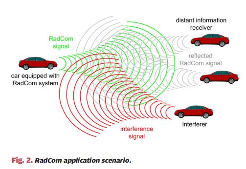
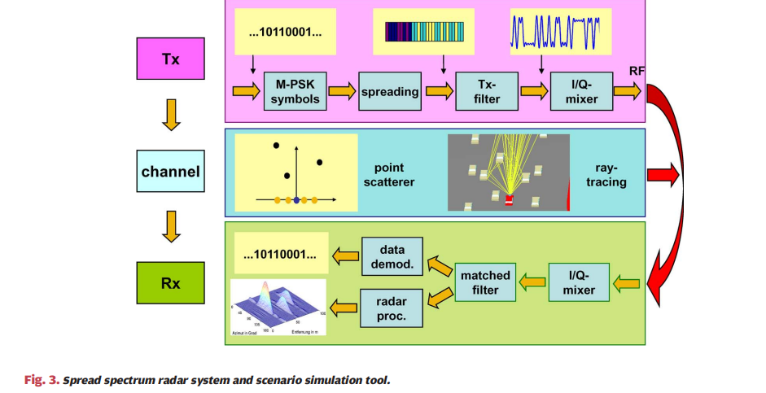
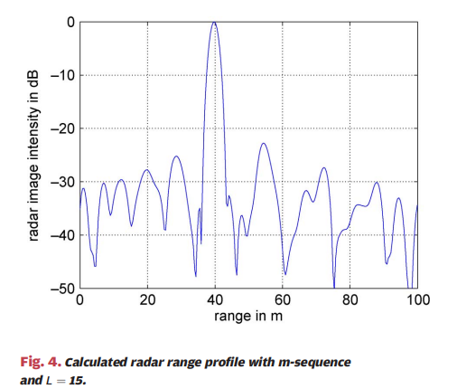
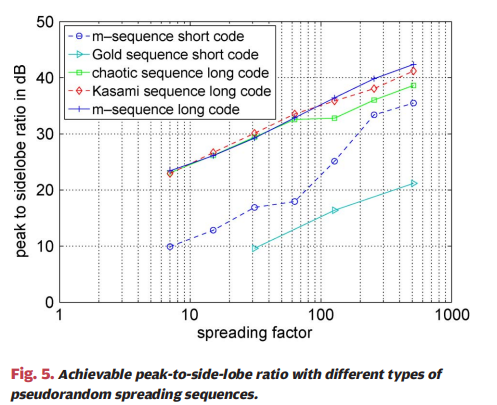
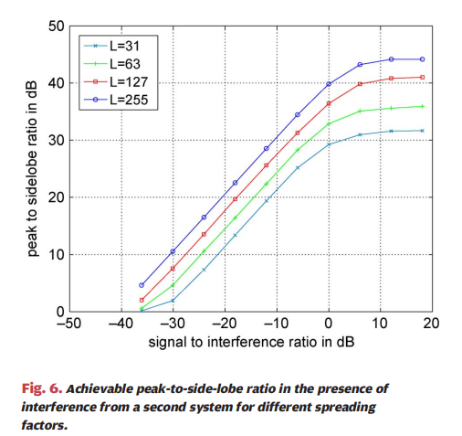
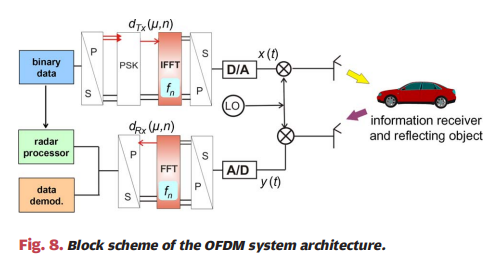
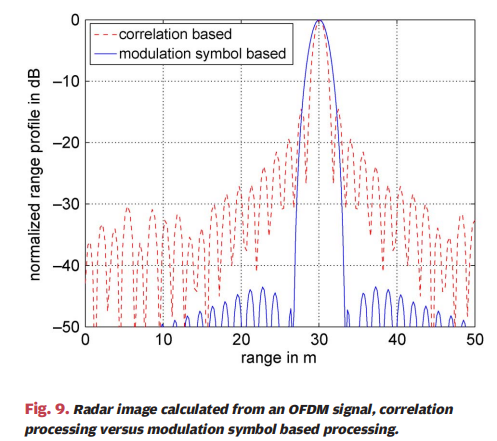
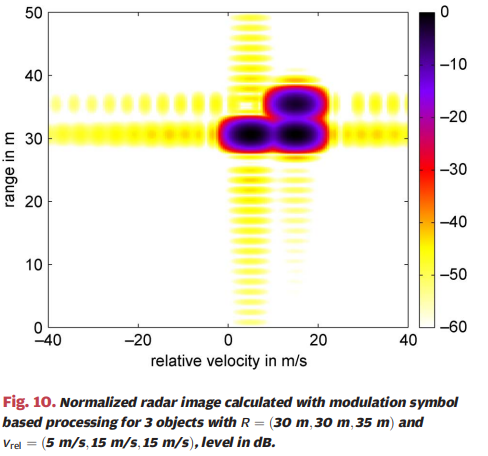
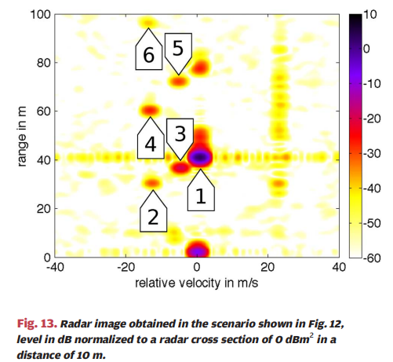
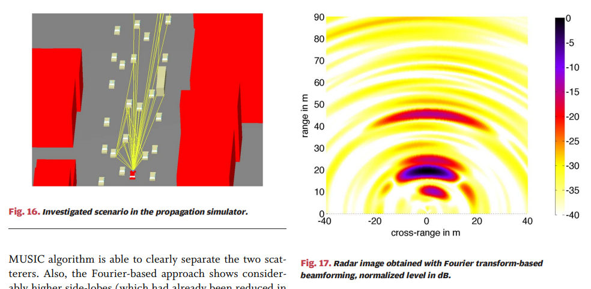
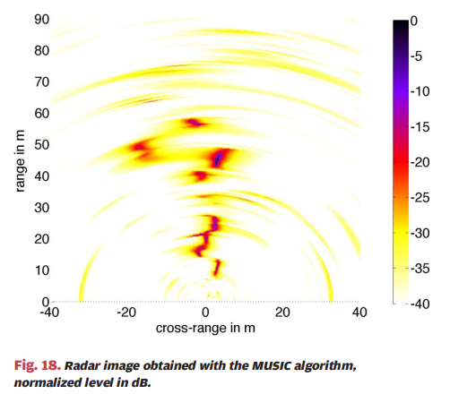

<!-- PAYMENT_BLOCK -->

## Get this dataset

- Payment link (Stripe): [Buy now](https://buy.stripe.com/3cs8yP7sY87d0vu9AB)
- Payment QR code: 

<!-- /PAYMENT_BLOCK -->
